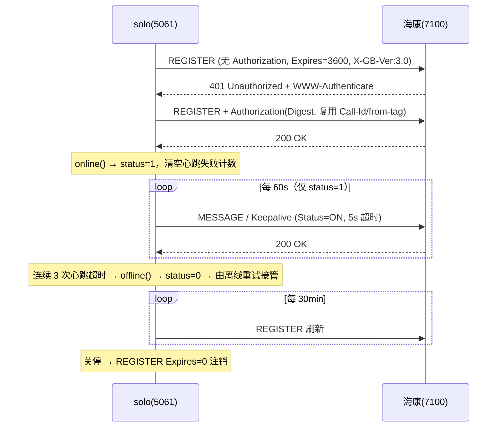

# 上级平台（GB/T 28181 级联）注册流程与实测结论

> 代码基线：solo 后端 `com.solo.gb28181.*`（Spring Boot 4.1 / jain-sip）
> 本文所有结论均来自当前仓库代码 + 2026-11-18 本机实测（含一次完整排障过程）。

---

## 一、本次实测结论（2026-11-18）

**结论：已注册成功。** 2026-11-18 17:17:26 `gb_parent_platform.status` 由 0 置 1，海康侧级联状态显示正常。

16:58 ~ 17:10 期间两次失败（无响应 → 400 Bad Request）的排查过程保留在 §1.4，是同一条链路的真实记录。

### 1.1 最终生效配置

| 项 | 值 | 来源 |
|---|---|---|
| 上级平台名称 | 海康平台35 | `gb_parent_platform.name` |
| 上级国标编码 / 域 | `37000020002000000100` / `3700002000` | `server_gb_id` / `server_gb_domain` |
| 上级地址 | `192.168.106.35:7100`（UDP） | `server_ip` / `server_port` / `transport` |
| 鉴权用户名 / 密码 | `adminhk123` / `adminhk123` | `username` / `password` |
| 有效期 / 心跳 | 3600s / 60s | `expires` / `keep_timeout` |
| **本平台 SIP ID** | **`34020000002000000001`** | `gb28181.id`，**必须等于海康「外域编码」** |
| **本平台 SIP 域** | **`3402000000`** | `gb28181.domain`（ID 前 10 位） |
| **本端信令端口** | **`5061`** | `gb28181.port`，**必须等于海康「信令通信端口」** |
| 本端 IP | `192.168.118.7` | `project.ip` → `gb28181.ip` |
| 协议版本标识 | `X-GB-Ver: 3.0` | 报文头，与已验证可注册的 voglander 一致 |

海康侧「编辑下级域」对应关系：外域编码 → `gb28181.id`；IP 地址 + 信令通信端口 → `gb28181.ip:port`；联网协议 GB/T 28181-2016；联网服务地址 `192.168.106.35:7099`（海康自身，不参与本次注册）。

### 1.2 成功判定依据

| # | 证据 | 说明 |
|---|---|---|
| 1 | `gb_parent_platform.status = 1`，`update_time = 17:17:26` | 只有收到 **200 OK** 才会被置 1（`PlatformRegisterServiceImpl.online`） |
| 2 | 日志出现 `[级联注册] 注册成功 -> 37000020002000000100` | 200 分支专属日志 |
| 3 | 海康侧级联状态显示正常 | 对方侧确认 |

### 1.3 成功路径的日志序列（供日后对照）

```
[级联注册] 发送 REGISTER 有效期:3600s → 上级平台:37000020002000000100 地址:192.168.106.35:7100
[SIP应答] REGISTER → status=401 reason=Unauthorized callId=...        ← 海康要求 Digest
[级联注册] 带认证重发 REGISTER 有效期:3600s → 上级平台:37000020002000000100
[SIP应答] REGISTER → status=200 reason=OK callId=...
[级联注册] 注册成功 -> 37000020002000000100
```

### 1.4 排障记录：两个根因、两次改动

| 时间 | 本端配置 | 现象 | 根因 |
|---|---|---|---|
| 16:58 | 端口 5060、ID `60000000042000000028` | 发完 REGISTER 后**完全无响应**，`status=0` | **端口不匹配**：海康按「源 IP + 源端口」匹配自己那边的下级域记录，5060 匹配不上直接丢包，连 401 都不回 |
| 17:03 → 17:10 | 端口改 **5061** | 37ms 内收到 `status=400 Bad Request` | **本端 SIP ID 不匹配**：海康「外域编码」登记的是 `34020000002000000001`，solo 发的是 `60000000042000000028` |
| 17:17 | ID/域改 **34020000002000000001 / 3402000000**，另对齐 To 头、补 `X-GB-Ver` | `status=1` | 全部身份参数对齐，注册成功 |

排障中顺带对齐的报文格式（与 voglander 成功抓包 `logs/_capture/pkts-20261106-172424/001.txt` 比对得出）：

- **To 头**：原为「本端编码 @ 上级域」（`sip:60000000042000000028@3700002000`），改为与 Request-URI 完全相同的「上级编码 @ 上级 IP:端口」
- **补 `X-GB-Ver: 3.0`**（GB/T 28181-2022 附录 I 协议版本标识）
- **REGISTER 应答日志补 `reason=`**，否则只有状态码、看不到对方给的原因

---

## 二、参与组件

| 组件 | 位置 | 职责 |
|---|---|---|
| `GbParentPlatformController` | `gb28181/controller` | `/api/gb28181/parent-platform/{save,update}` 入口，带权限与操作日志 |
| `GbParentPlatformServiceImpl` | `gb28181/service/impl` | 落库后**立即触发一次注册**（`create` 置 status=0；`updatePlatform` 保留原 status） |
| `PlatformRegisterServiceImpl` | `gb28181/service/impl` | 注册生命周期编排：`register` / `registerAll` / `registerOffline` / `refreshAll` / `keepaliveAll` / `online` / `offline` / `unregisterAll` |
| `CascadeScheduledTasks` | `gb28181/task` | 三个 `@Scheduled`：启动注册、心跳+离线重试、30min 刷新；`@PreDestroy` 注销 |
| `PlatformCommander` | `gb28181/transmit/cmd` | 真正发包：`register`（首包）、`registerWithAuth`（401 后带 Digest 重发）、`keepalive`（Notify） |
| `PlatformSipHeaderProvider` | `gb28181/transmit/cmd` | 构造 REGISTER/MESSAGE/NOTIFY/BYE 各头；Digest 计算 |
| `RegisterResponseProcessor` | `gb28181/processor/response` | 按方法名 `REGISTER` 处理 401 / 200 / 其他 |
| `SipProcessorObserver` | `gb28181/sip` | 响应分发；`REGISTER`/`MESSAGE` 应答统一打 `[SIP应答]` 日志 |
| `PlatformRegisterState` | `gb28181/transmit/cmd` | **纯内存**瞬态：`callId → 注册事务方向`、`serverGbId → 心跳连续超时次数`（不落 Redis） |
| `SipSender` / `SipLayer` | `gb28181/sip` | 统一发送入口、Provider 绑定 |

---

## 三、配置与报文映射

### 3.1 配置来源

- **全局（本平台身份）**：`application.yaml` → `gb28181.ip / port / id / domain / public-ip`。级联与设备侧共用同一套身份，per-upper 只存对端配置（ADR-018 / ADR-036）。
- **每个上级**：`gb_parent_platform` 一行（`server_gb_id` 创建后不可改）。

### 3.2 REGISTER 各头取值（`PlatformSipHeaderProvider.createRegisterRequest`）

| 头 | 取值（成功配置） | 规则 |
|---|---|---|
| Request-URI | `sip:37000020002000000100@192.168.106.35:7100` | `serverGbId @ serverIp:serverPort` |
| Via | `SIP/2.0/UDP 192.168.118.7:5061;rport;branch=...` | 全局 `gb28181.ip:port`，带 `rport` |
| From | `sip:34020000002000000001@3402000000;tag=<随机>` | 本平台 ID @ 本平台域（ADR-035） |
| To | `sip:37000020002000000100@192.168.106.35:7100` | **与 Request-URI 完全相同**（海康对旧写法回 400） |
| Contact | `sip:34020000002000000001@192.168.118.7:5061` | 本平台 ID @ 本平台出口 IP:端口 |
| CSeq | `<全局种子自增> REGISTER` | 与设备侧独立；各类请求共用同一计数器 |
| Expires | `3600` | `gb_parent_platform.expires`，无值回落 3600；注销传 0 |
| X-GB-Ver | `3.0` | GB/T 28181-2022 附录 I 协议版本标识 |
| Authorization | 首包**无** | 收到 401 后由 `buildAuthorization` 补 |

### 3.3 Digest 认证（401 后重发）

```
HA1 = md5(username : realm : password)
HA2 = md5("REGISTER" : requestUri)
response = qop 存在 → md5(HA1 : nonce : nc : cnonce : qop : HA2)
           qop 缺失 → md5(HA1 : nonce : HA2)
```
- `username`：`gb_parent_platform.username`，留空回落本平台 SIP ID（海康实际按 `adminhk123`）
- `algorithm` 固定 `MD5`；`nc` 固定 `00000001`；`cnonce` 每次随机
- 复用 401 回显的 `Call-Id` 与 `From-tag`

---

## 四、注册全流程

### 4.1 触发点

| 触发 | 时机 | 方法 |
|---|---|---|
| 前端新增/编辑保存 | 请求返回前异步触发 | `create/updatePlatform` → `register(@Async "taskExecutor")` |
| 服务启动 | 启动后 10s，一次 | `cascadeRegisterOnStartup` → `registerAll`（所有 enabled） |
| 离线重试 | 每 60s | `cascadeKeepalive` → `registerOffline`（enabled 且 status≠1） |
| 定期刷新 | 每 30min | `cascadeRefresh` → `refreshAll`（所有 enabled） |
| 关停 | `@PreDestroy` | `unregisterAll`（status=1 的发 Expires=0） |

### 4.2 成功路径时序



### 4.3 状态存储

| 状态 | 位置 | 说明 |
|---|---|---|
| 在线/离线 | `gb_parent_platform.status` | 唯一权威；`update_time` 由 DB `ON UPDATE` 维护 |
| 注册事务归属 | `PlatformRegisterState.registerCallId`（内存） | `callId → {serverGbId, register?}` |
| 心跳失败次数 | `PlatformRegisterState.keepaliveFail`（内存） | 阈值 3 |
| Redis | **不使用** | 单机部署，级联态不落 Redis（ADR-018） |

### 4.4 响应分支（`RegisterResponseProcessor`）

| 状态码 | 处理 | 日志 |
|---|---|---|
| 401 | 取 `WWW-Authenticate` → `registerWithAuth`（保留 callId 映射等 200） | `[级联注册] 带认证重发 ...` |
| 200 | `register=true` → `online()` 置 1；`register=false` → `offline()` 置 0 | `[级联注册] 注册成功 -> xxx` / `注销成功` |
| 其他（400/403/500…） | `offline()` 置 0，清 callId | `[级联注册] 注册失败 status=xxx -> xxx` |
| 401 无 `WWW-Authenticate` | 放弃本次 | `[级联注册] 401 无 WWW-Authenticate 头，放弃` |
| Call-Id 找不到事务 | 忽略 | `[级联注册] callId=... 无对应注册事务` |

---

## 五、排查决策树（同一上级再次出问题时用）

```
日志停在 "发送 REGISTER"，且没有任何 [SIP应答] 行
└─ 报文被对端丢弃 → 优先怀疑「源 IP + 源端口」与对端登记不一致
    · 本端 gb28181.ip 是否为对端登记的 IP
    · 本端 gb28181.port 是否为对端「信令通信端口」

收到 [SIP应答] REGISTER status=400
└─ 报文已到达、被判定不合法 → 依次核对
    · From/Contact 里的 SIP ID 是否等于对端「外域编码」
    · To 是否与 Request-URI 一致
    · 是否缺 X-GB-Ver

收到 status=401，之后无 200（且无"带认证重发"）
└─ 认证头问题 → 核对 username/password、realm/nonce 解析、qop 分支

收到 status=403 / 404
└─ 报文通、身份被拒 → 对端未登记该 ID 或密码错误

提示 status=200 但 status 仍为 0
└─ 看是否 `callId 无对应注册事务`（callId 映射丢失）
```

---

## 六、与 voglander（同一上级、已验证可注册）的差异

voglander `tb_cascade_platform.id=1`：`register_status=1`，关键配置与 solo 最终态对照：

| 项 | voglander | solo（最终） | 结论 |
|---|---|---|---|
| 本端 SIP ID | `local_client_id=34020000002000000001` | `gb28181.id=34020000002000000001` | 一致（关键） |
| 本端端口 | 5061 | 5061 | 一致（关键） |
| 本端通告地址 | `sip.client.domain=192.168.118.7`（From/Contact 用 IP） | `gb28181.domain=3402000000`（From 用域） | 差异但可接受：标准写法为域，海康已接受 |
| 401 重发 CSeq | 原值 + 1 | 全局种子自增 | 差异，海康未拒；遇严格实现再改 |
| Via | 无 `rport` | 带 `rport` | 差异，海康未拒 |
| 心跳 Status | 需 `ON` | `ON` | 一致 |
| 心跳周期 | `keepalive_interval=60` | 固定 60s（`keep_timeout` 列未使用） | 值相同 |
| User-Agent | `null`（框架 bug） | 未发送 | 海康未拒 |

> 注意：两者使用同一个外域编码 + 同一个 `192.168.118.7:5061`，**不能同时注册同一个海康**，否则互相顶掉。

---

## 七、已知缺口与加固建议

1. **删除上级平台不发注销**：`GbParentPlatformServiceImpl.deleteBatch` 只 `removeByIds`，残留注册关系要等对方 Expires 到期。
2. **编辑平台不清 status**：编辑后保留旧 status，原为在线会继续发心跳直到被判离线；语义上应立即置 0 并重注册。
3. **心跳周期不读 `keep_timeout`**：固定 60s，与 DB 列无关联，易误导运维。
4. **401 重发未按 RFC 复用"原值 + 1"**：当前用全局种子递增值，其它报文穿插时可能跳号。
5. **心跳的 401 被当作成功**：`SipProcessorObserver` 订阅回调把 401 归入成功分支（`isOk`），若海康对 Keepalive 要求 Digest 而本端未带，会"假在线"——目前海康未拒，列为观察项。
6. **首包无本地超时告警**：仅依赖 jain-sip `Timer B` 打 `[消息分发] 事务超时`，建议补 5s 主动检查。

---

## 八、后续验证（注册成功之后）

1. **心跳稳定性**：连续观察 ≥3 个 60s 周期，`status` 应保持 1（连续 3 次超时才判离线）。
2. **目录为空**：`solo_db` 当前 `gb_device=0`、`gb_device_channel=0`，海康下发 Catalog 查询时本端只能回空目录。要验证级联业务需先接入设备/通道，并在「上级平台 → 共享」里挂载。
3. **设备侧身份已变**：本平台国标 ID 现为 `34020000002000000001`、域 `3402000000`，后续设备接入时「平台 SIP ID / 服务器域」需按此填写。
